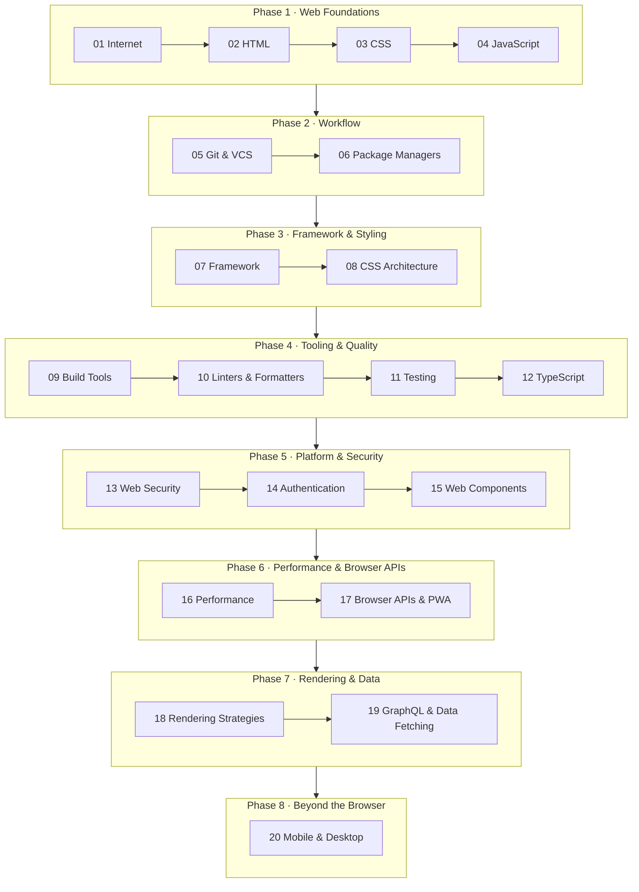

# Front-End Roadmap

This roadmap reorganizes [roadmap.sh/frontend](https://roadmap.sh/frontend) into **8 sequential
phases**. Every stage uses the same format: *Why it matters → Concept map → How to learn → Check
your understanding → Practice projects → Primary sources → Related toolkit.*

Read [How to learn](../how-to-learn.md) first so you know how to use each page.

## Stages

| # | Stage | Phase | Estimate | Deep-dive focus |
| --- | --- | --- | --- | --- |
| 01 | [Internet](01-internet.md) | 1 | 1 wk | The journey of a request from URL to pixels |
| 02 | [HTML](02-html.md) | 1 | 1–2 wks | Semantics, the a11y tree, HTML parsing |
| 03 | [CSS](03-css.md) | 1 | 3–4 wks | Cascade, formatting contexts, layout algorithms |
| 04 | [JavaScript](04-javascript.md) | 1 | 4–6 wks | Event loop, closures, prototypes, memory |
| 05 | [Git & VCS](05-git-vcs.md) | 2 | 1 wk | Git's object model |
| 06 | [Package Managers](06-package-managers.md) | 2 | 1 wk | Dependency resolution, lockfiles, node_modules layout |
| 07 | [Framework (React & others)](07-framework.md) | 3 | 4–6 wks | Reconciliation, reactivity, scheduling |
| 08 | [CSS Architecture & Tools](08-css-architecture.md) | 3 | 2 wks | Scaling styles, design tokens |
| 09 | [Build Tools](09-build-tools.md) | 4 | 2–3 wks | Module graph, tree-shaking, HMR |
| 10 | [Linters & Formatters](10-linters-formatters.md) | 4 | 3 days | AST |
| 11 | [Testing](11-testing.md) | 4 | 2–3 wks | Test strategy, test doubles, stable E2E |
| 12 | [TypeScript](12-typescript.md) | 4 | 3–4 wks | Type system, generics, inference |
| 13 | [Web Security](13-web-security.md) | 5 | 2 wks | Same-origin policy, XSS, CSP |
| 14 | [Authentication](14-authentication.md) | 5 | 1–2 wks | Session vs token, OAuth/OIDC flows |
| 15 | [Web Components](15-web-components.md) | 5 | 1 wk | Shadow DOM, custom element lifecycle |
| 16 | [Performance](16-performance.md) | 6 | 3–4 wks | Core Web Vitals, rendering pipeline |
| 17 | [Browser APIs & PWA](17-browser-apis.md) | 6 | 2–3 wks | Service workers, storage, realtime |
| 18 | [Rendering Strategies](18-rendering-strategies.md) | 7 | 2–3 wks | CSR/SSR/SSG/ISR, hydration, RSC |
| 19 | [GraphQL & Data Fetching](19-graphql-data-fetching.md) | 7 | 2 wks | Caching, normalization, stale-while-revalidate |
| 20 | [Mobile & Desktop](20-mobile-desktop.md) | 8 | 2 wks | React Native, Flutter, Electron, Tauri |

Estimates assume 5–8 hours a week. If you're experienced, Phases 1–2 can go faster, as long as you
can answer their *Check your understanding* questions.

## Deep dives

Topics that go deeper than the roadmap live in [Deep dives](../deep-dives/index.md).

## After this roadmap

Relevant next tracks: advanced TypeScript, Node.js, and Fullstack. Architecture topics like design
systems, micro-frontends, and observability are on the deep-dive list.
