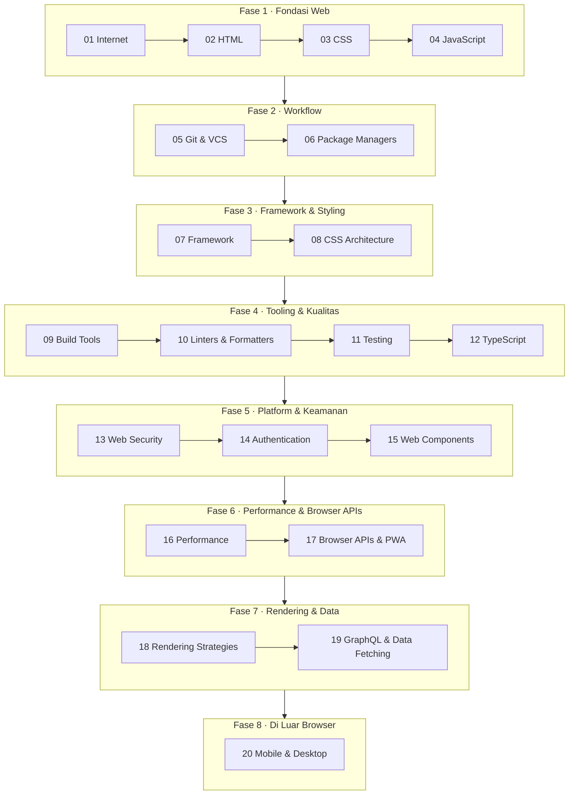

# Roadmap Front-End

Roadmap ini disusun ulang dari [roadmap.sh/frontend](https://roadmap.sh/frontend) menjadi
**8 fase berurutan**. Tiap tahap punya format yang sama: *Kenapa ini penting → Peta konsep →
Cara belajar → Uji pemahaman → Proyek latihan → Sumber primer → Toolkit terkait.*

Baca [Metode Belajar](../how-to-learn.md) dulu supaya cara memakai tiap halaman jelas.

## Daftar tahap

| # | Tahap | Fase | Estimasi | Fokus deep dive |
| --- | --- | --- | --- | --- |
| 01 | [Internet](01-internet.md) | 1 | 1 mgg | Perjalanan request dari URL sampai pixel |
| 02 | [HTML](02-html.md) | 1 | 1–2 mgg | Semantik, a11y tree, parsing HTML |
| 03 | [CSS](03-css.md) | 1 | 3–4 mgg | Cascade, formatting context, layout algorithm |
| 04 | [JavaScript](04-javascript.md) | 1 | 4–6 mgg | Event loop, closure, prototype, memory |
| 05 | [Git & VCS](05-git-vcs.md) | 2 | 1 mgg | Object model Git |
| 06 | [Package Managers](06-package-managers.md) | 2 | 1 mgg | Resolusi dependensi, lockfile, node_modules layout |
| 07 | [Framework (React & lainnya)](07-framework.md) | 3 | 4–6 mgg | Reconciliation, reactivity, scheduling |
| 08 | [CSS Architecture & Tools](08-css-architecture.md) | 3 | 2 mgg | Skalabilitas styling, design tokens |
| 09 | [Build Tools](09-build-tools.md) | 4 | 2–3 mgg | Module graph, tree-shaking, HMR |
| 10 | [Linters & Formatters](10-linters-formatters.md) | 4 | 3 hari | AST |
| 11 | [Testing](11-testing.md) | 4 | 2–3 mgg | Strategi test, test doubles, E2E yang stabil |
| 12 | [TypeScript](12-typescript.md) | 4 | 3–4 mgg | Type system, generics, inference |
| 13 | [Web Security](13-web-security.md) | 5 | 2 mgg | Same-origin policy, XSS, CSP |
| 14 | [Authentication](14-authentication.md) | 5 | 1–2 mgg | Session vs token, OAuth/OIDC flows |
| 15 | [Web Components](15-web-components.md) | 5 | 1 mgg | Shadow DOM, custom elements lifecycle |
| 16 | [Performance](16-performance.md) | 6 | 3–4 mgg | Core Web Vitals, rendering pipeline |
| 17 | [Browser APIs & PWA](17-browser-apis.md) | 6 | 2–3 mgg | Service worker, storage, realtime |
| 18 | [Rendering Strategies](18-rendering-strategies.md) | 7 | 2–3 mgg | CSR/SSR/SSG/ISR, hydration, RSC |
| 19 | [GraphQL & Data Fetching](19-graphql-data-fetching.md) | 7 | 2 mgg | Caching, normalisasi, stale-while-revalidate |
| 20 | [Mobile & Desktop](20-mobile-desktop.md) | 8 | 2 mgg | React Native, Flutter, Electron, Tauri |

Estimasi ditulis untuk ritme 5–8 jam per minggu. Bagi yang sudah berpengalaman, Fase 1–2 bisa
lebih cepat, asalkan *Uji pemahaman*-nya bisa dijawab.

## Deep dives

Topik yang lebih dalam dari roadmap ada di [`docs/deep-dives/`](../deep-dives/index.md).

## Setelah roadmap ini

Jalur lanjutan yang relevan: TypeScript lanjut, Node.js, dan Fullstack. Topik arsitektur seperti
design system, micro-frontend, dan observability ada di daftar deep dive.
